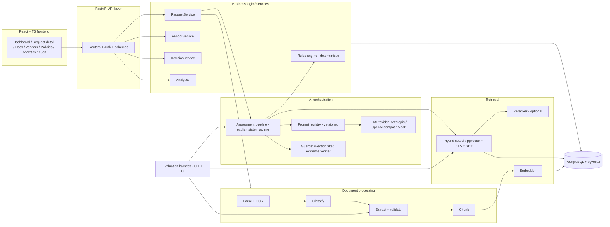

# Architecture Proposal — Procura AI

## 1. Guiding decisions

| Decision | Choice | Alternatives considered | Why |
|---|---|---|---|
| Backend | FastAPI + Pydantic v2 + SQLAlchemy 2 + Alembic | Django, Node | Pydantic is central (strict extraction/LLM schemas); async FastAPI fits LLM I/O |
| DB | PostgreSQL 16 + **pgvector** + built-in FTS | Qdrant/Chroma + Postgres | One datastore → transactional consistency between rows and vectors, hybrid search in SQL, free, one container. Dedicated vector DBs add ops with no benefit at this scale (<100k chunks) |
| Embeddings | `sentence-transformers` — default `BAAI/bge-small-en-v1.5` (384-d); multilingual option `intfloat/multilingual-e5-small` for Arabic | OpenAI embeddings | Free, local, swappable via `Embedder` interface. Dimension stored per index so models can be swapped with re-index |
| Reranker | `cross-encoder/ms-marco-MiniLM-L-6-v2`, **optional**, enabled only if eval shows gain | none | Decided by measurement |
| LLM | `LLMProvider` interface: Anthropic, OpenAI-compatible (covers Ollama/LM Studio), Mock | LangChain | Thin own adapter + Pydantic structured output + retries. **No LangChain.** A small LangGraph-style state machine is hand-written (the pipeline is a fixed DAG, not an open-ended agent) |
| Doc parsing | PyMuPDF; Tesseract (pytesseract) for OCR, optional | Unstructured, cloud OCR | Free, fast; OCR detected at runtime and degraded gracefully |
| Frontend | React + TypeScript + Vite + Tailwind + shadcn/ui (Radix) + TanStack Query + Recharts | Next.js | SPA behind an API; no SSR need. shadcn gives owned, customizable components rather than a template |
| Jobs | In-process async worker + `jobs` table (Postgres `SKIP LOCKED`) | Celery/Redis | Avoids Redis; sufficient for demo scale |
| Auth | Demo roles (requester/reviewer/admin) with signed token; not production auth | Full IdP | Honest scope; documented as limitation |

## 2. System diagram



Layering rule: `api → services → (rules | ai | retrieval | documents) → db`. No layer imports upward. AI/retrieval/documents packages do not import FastAPI.

## 3. Database schema (PostgreSQL)

All PKs are UUID unless noted. All tables have `created_at`. `*_json` = JSONB.

**Identity & config**
- `users(id, email, name, role[requester|reviewer|admin], department)`
- `app_settings(key, value_json)`

**Documents & retrieval**
- `documents(id, filename, sha256 unique, mime, doc_type[policy|quotation|invoice|contract|purchase_request|other], doc_type_confidence, language, is_synthetic bool, status[uploaded|parsed|extracted|indexed|failed], ocr_used bool, page_count, uploaded_by→users, request_id→purchase_requests nullable, storage_path)`
- `document_pages(id, document_id, page_no, text, ocr_confidence)`
- `extractions(id, document_id, schema_name, schema_version, data_json, field_provenance_json, validation_errors_json, method[rules|llm|mock], prompt_version nullable)`
- `policies(id, code, title, version, effective_from, effective_to, category, document_id, status)`
- `chunks(id, document_id, policy_id nullable, page_start, page_end, section_path, text, char_start, char_end, token_count, metadata_json, embedding vector(384), embedding_model, tsv tsvector)` — HNSW index on embedding, GIN on tsv, btree on policy_id/category.
- `policy_rules(id, policy_id, rule_code, description, category, params_json, source_chunk_id→chunks, active)` — deterministic rules reference the clause they implement.

**Requests**
- `purchase_requests(id, request_no unique, requester_id, department, currency, total_amount numeric(14,2), supplier_id nullable, justification, category, status[submitted|assessed|info_requested|approved|rejected], submitted_at, fingerprint)`
- `request_items(id, request_id, description, quantity, unit_cost numeric(14,4), line_total, category, item_embedding vector(384))`
- `request_documents(request_id, document_id, role)`

**Vendors**
- `vendors(id, canonical_name, normalized_name unique, country nullable, tax_id nullable, contact_json, first_seen_doc_id)`
- `vendor_aliases(id, vendor_id, alias, source_doc_id)`
- `quotations(id, vendor_id, request_id nullable, document_id, quote_no, issue_date, valid_until, currency, subtotal, tax, total, payment_terms, delivery_days)`
- `quotation_items(id, quotation_id, description, quantity, unit_price, line_total, request_item_id nullable)`

**Assessments (AI) — separate from decisions (human)**
- `assessments(id, request_id, version int, overall_risk, compliance_status, confidence numeric, summary, financial_risks_json, next_steps_json, missing_info_json, provider, model, prompt_versions_json, is_mock bool, latency_ms, input_tokens, output_tokens, est_cost_usd, created_at)` — new row per run, never updated.
- `findings(id, assessment_id, category[confirmed_violation|potential_violation|missing_information|compliant|inconclusive], source[rule|llm], rule_code nullable, title, explanation, confidence, severity)`
- `finding_evidence(id, finding_id, kind[policy_chunk|request_field|document_span|quotation], chunk_id nullable, quote text, ref_json)` — **a finding with zero evidence is rejected at write time** (except `INCONCLUSIVE` which states why).
- `retrieval_logs(id, assessment_id, query, filters_json, results_json[chunk_id, scores, rank], reranked bool)`
- `llm_calls(id, assessment_id nullable, purpose, provider, model, prompt_name, prompt_version, input_tokens, output_tokens, latency_ms, est_cost_usd, retries, status, error)`

**Human decisions & audit**
- `decisions(id, request_id, assessment_id, reviewer_id, action[approve|reject|request_info], reasoning text not null, created_at)`
- `finding_reviews(id, decision_id, finding_id, verdict[agree|disagree|unsure], note)`
- `info_requests(id, request_id, decision_id, message, resolved_at)`
- `audit_log(id bigserial, ts, actor_type[user|system|ai], actor_id, action, entity_type, entity_id, payload_json, prev_hash, hash)` — hash-chained, insert-only (DB role has no UPDATE/DELETE; enforced by trigger).

**Eval**
- `eval_runs(id, git_sha, config_json, started_at, metrics_json)`, `eval_case_results(id, run_id, case_id, suite, expected_json, actual_json, passed)`

Invariant enforced by DB constraint + service test: `purchase_requests.status='approved'` only reachable through a `decisions` row with `action='approve'`.

## 4. Directory structure

```
procura-ai/
├─ README.md  docs/  .env.example  docker-compose.yml  Makefile
├─ backend/
│  ├─ pyproject.toml  alembic.ini  migrations/
│  └─ app/
│     ├─ main.py  config.py  logging.py
│     ├─ api/            # routers, deps, auth, error handlers
│     ├─ schemas/        # Pydantic API + domain models (strict)
│     ├─ db/             # engine, models, repositories
│     ├─ services/       # request, vendor, decision, analytics, audit
│     ├─ rules/          # deterministic engine + rule definitions
│     ├─ documents/      # parse, ocr, classify, extract, validate, chunk
│     ├─ retrieval/      # embedder, vector store, fts, fusion, rerank, index
│     ├─ ai/
│     │  ├─ providers/   # base.py, anthropic.py, openai_compat.py, mock.py
│     │  ├─ prompts/     # versioned templates: name@vN.md + registry
│     │  ├─ pipeline/    # assessment state machine, steps
│     │  ├─ guards/      # injection scan, evidence verifier
│     │  └─ usage.py     # tokens, latency, cost
│     └─ jobs/           # queue worker
│  └─ tests/             # unit/ integration/ golden/
├─ evals/
│  ├─ datasets/          # gold cases (synthetic, labelled)
│  ├─ runners/           # retrieval, extraction, assessment
│  ├─ metrics.py  reports/   # real run outputs only, git-tracked
├─ data/synthetic/       # generator + generated policies, requests, quotes, contracts, invoices (PDF+JSON)
│  └─ generate.py        # seeded, reproducible
├─ frontend/             # Vite + React + TS (src/pages, components, api, lib)
└─ .github/workflows/    # ci.yml (lint, tests, eval smoke)
```

## 5. AI processing pipeline (assessment)

Explicit state machine, each step logged and individually testable; failures degrade to `inconclusive`, not to a guess.

1. **Intake validation** (deterministic): Pydantic strict model; missing/inconsistent field checks → `MISSING_INFORMATION` findings.
2. **Document processing** (rules first): parse → OCR if no text layer → classify (keyword/layout rules; LLM only if confidence < threshold) → extract (regex/table parsing for quotes+invoices where layouts are templated; LLM structured extraction fallback) → arithmetic validation → vendor normalization.
3. **Injection scan** on all untrusted text: pattern + heuristic detection of instruction-like content ("ignore previous…", role tags, policy-override claims). Hits are flagged as findings, and text is passed to the LLM only inside delimited data blocks marked untrusted.
4. **Duplicate check**: fingerprint + vector similarity.
5. **Retrieval**: query built from request category, items, amount, supplier, plus rule-triggered sub-queries (e.g. "competitive quotes above X"). Hybrid search with effective-date and category filters. **Relevance gate**: top score below threshold → no LLM compliance reasoning for that topic; emit `INCONCLUSIVE` ("no applicable policy retrieved").
6. **Rules engine** (deterministic): thresholds, number of quotes, approved vendor list, required approvals by amount, quote validity, currency, split-purchase pattern. Each rule links to `policy_rules.source_chunk_id`. Emits `CONFIRMED_VIOLATION` / `COMPLIANT` with evidence.
7. **LLM reasoning** (only for what rules can't decide: ambiguous justification adequacy, category interpretation, clause conflicts, soft requirements): input = request facts + retrieved chunks (with ids) + rule results. Output = Pydantic-validated JSON; each claim must reference chunk ids. Max `POTENTIAL_VIOLATION`.
8. **Evidence verifier**: every cited quote must be a substring (normalized) of the cited chunk; every chunk id must come from this retrieval; numbers in explanations must match request fields. Failing findings are dropped and counted toward the unsupported-claim metric.
9. **Aggregation**: deterministic risk scoring from findings (weights documented); confidence = f(retrieval scores, verifier pass rate, extraction confidences) — heuristic, labelled uncalibrated until calibration is measured in eval.
10. **Persist** assessment + findings + evidence + retrieval/LLM logs; audit entry. Request → `assessed`. Never `approved`.

**What uses a real model vs deterministic logic**

| Component | v1 |
|---|---|
| Embeddings | real (local sentence-transformers) |
| Text extraction, OCR, chunking | deterministic |
| Doc classification | rules/keywords; LLM fallback |
| Quote/invoice/request field extraction | rules + LLM structured fallback (measured separately) |
| Threshold/quote-count/vendor-list checks | deterministic |
| Justification adequacy, ambiguous clause interpretation, summary, next steps | LLM |
| Evidence verification, duplicate detection, vendor normalization, risk scoring | deterministic (+ embeddings) |

## 6. RAG architecture

6.1 **Ingestion:** policy PDF → pages → section tree via heading regex/font-size → clause-level chunks (target 150–400 tokens, never splitting a numbered clause; parent section path kept; small overlap only inside long clauses). Contextual header prepended for embedding only (`"[Policy PRC-003 §4.2 Quotes]"`), raw text stored for citation.
6.2 **Indexing:** embed with configured model; store model name and dim; re-index command when changed.
6.3 **Retrieval:** dense top-30 (cosine, HNSW) + FTS top-30 (`ts_rank_cd`) → Reciprocal Rank Fusion → filters (active on request date, category) → optional cross-encoder rerank → top-k (default 6).
6.4 **Context relevance check:** score thresholds tuned on eval set (not guessed) + optional LLM judge only in eval.
6.5 **Prompt-injection defense:** (a) instructions only in system prompt, documents only in delimited, escaped data blocks; (b) LLM has no tools and no ability to write state — output is a schema-validated recommendation; (c) injection scan flags suspicious content to the reviewer; (d) evidence verifier blocks claims unsupported by retrieved *policy* chunks (vendor docs cannot become "policy"); (e) policies come only from admin-uploaded docs with `doc_type=policy`. Residual risk documented.
6.6 **Swappability:** `Embedder`, `VectorStore`, `Reranker`, `LLMProvider` are `Protocol`s; selected by config; contract tests run against every implementation.

## 7. Cross-cutting
- **Structured outputs:** providers expose `generate(schema: type[BaseModel], …)`; uses native tool/JSON mode where available, otherwise JSON + validation; retry with error feedback up to N=2, exponential backoff for transient errors, timeouts everywhere.
- **Prompt versioning:** files `prompts/<name>@vN.md`, content hash recorded in `llm_calls`/`assessments`; no edits in place.
- **Observability:** JSON logs with request id; `llm_calls` table; `/metrics`-style summary in Analytics (tokens, latency, cost).
- **Mock provider:** keyed by hash of (prompt_name, version, normalized input) → recorded fixture; unknown input returns a clearly marked generic mock result. Recorded fixtures are produced from real runs when possible; labelled `is_mock=true` end-to-end.
- **Error handling:** typed domain errors → problem+json responses; pipeline failures recorded as assessment `inconclusive` with reason.

## 8. API sketch
`POST /requests`, `GET /requests`, `GET /requests/{id}`, `POST /requests/{id}/documents`, `POST /requests/{id}/assess`, `GET /requests/{id}/assessments`, `POST /requests/{id}/decisions`, `GET /documents/{id}`, `POST /documents`, `GET /policies`, `POST /policies/search` (debug retrieval), `GET /vendors`, `GET /vendors/{id}/compare`, `GET /analytics/*`, `GET /audit`, `GET /health/live|ready`.

## 9. Frontend
Dark theme, violet/blue accent tokens, Inter + a mono face for IDs/numbers, dense tables with sticky headers, motion limited to 150–200 ms transitions. Request Detail is a three-lane layout: **AI Findings** (grouped by the five categories, each expandable to evidence), **Evidence panel** (policy text with highlighted quote, request field), **Human decision** (separate card, visually distinct, with agree/disagree per finding and mandatory reasoning). A persistent badge shows `MOCK` vs real model + prompt versions.

## 10. Local & deployment
**No Docker required.** Database is a free hosted Postgres with pgvector (Neon free tier; Supabase is the alternative), configured by `DATABASE_URL` in `.env`. Separate Neon branches/databases for dev, test and demo. An optional `docker-compose.yml` for local Postgres may be added later for contributors who want it. Backend and frontend run natively (`make dev`). Tesseract is optional (OCR tests skipped if absent). Deployment (later): Neon/Supabase free Postgres (pgvector supported) + Render/Fly free tier for API + Vercel/Netlify for frontend; sentence-transformers memory (~200 MB for bge-small) may exceed free-tier limits → fallback is precomputed embeddings in demo or an HF Inference endpoint; decide at M13.

## 11. Weaknesses I already see
- Synthetic eval data inflates metrics; mitigated by adversarial cases and honest reporting.
- Heuristic confidence isn't calibrated; labelled as such.
- Free-tier hosting may not fit the embedding model.
