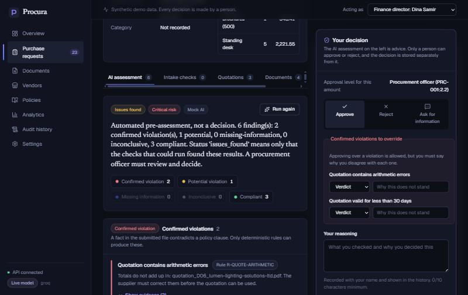
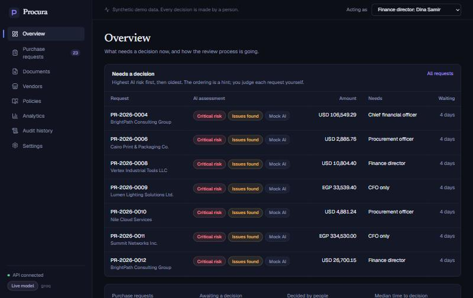
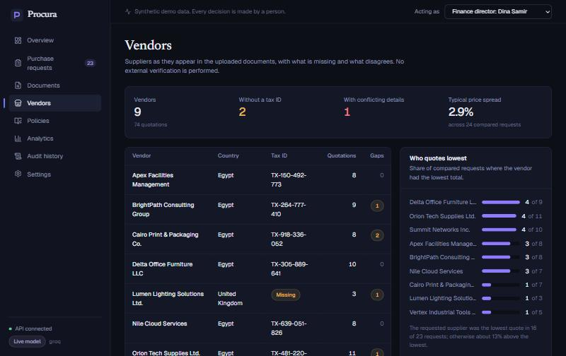
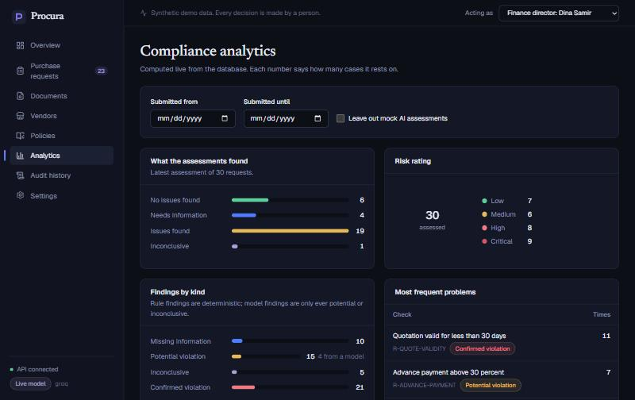
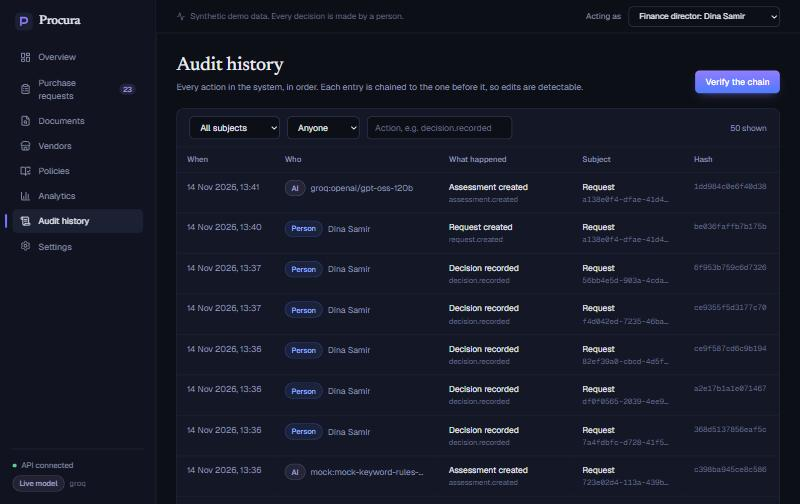
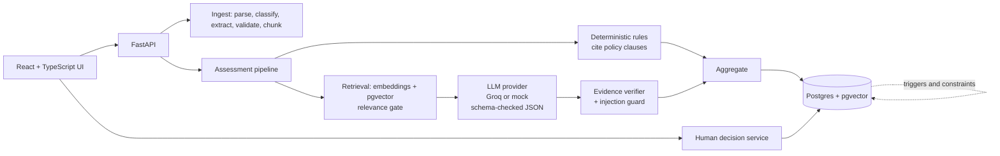

# Procura AI: a procurement review assistant where the AI never decides

Procura AI helps a procurement team review purchase requests against company policy. It reads the documents, finds the policy clauses that apply, runs deterministic checks, asks a language model about the judgement calls, and hands a reviewer an evidence-backed assessment. **A person always makes the decision. The software cannot approve or reject a purchase, and that is enforced in the database, not just in the interface.**

This write-up is about the engineering choices and what was actually measured. Every number comes from a report file in `evals/reports/` or from a count taken on the repository (sources are named). Where something is weak, untested or not built, it says so.

> **Status in one paragraph.** Built and tested: backend (FastAPI, Postgres with pgvector), the AI pipeline, the web UI and an evaluation harness. **Live demo:** https://mazenkarim20033-arch.github.io/procura-ai/, a recorded read-only snapshot with no backend. **Not done:** no live backend is deployed; the demo data was assessed by a keyword-based *mock* AI, with a real model (Groq) only used in the benchmarks; there is no real authentication (identities are demo personas); there are no scanned documents, no real company data, no Arabic and no browser end-to-end test suite. All data is synthetic.

## 1. The problem and the rule that shaped everything

Reviewing a purchase request means checking quotations, approval levels and supplier details against long policy documents. It is slow and inconsistent, which makes it a tempting place for "AI approves purchases". That would be the wrong product: a wrong approval spends real money, and a language model can state a policy violation that does not exist or miss one that does.

So the rule was set before any code: **the AI advises, a human decides, and the system must make the opposite impossible, not just unlikely.**

## 2. What it does

The reviewer opens a request and sees the AI assessment on the left and, separately, their own decision on the right.

- Findings are sorted by how sure the system can be. A **confirmed violation** is a fact in the file that contradicts a policy clause, and only deterministic rules can produce one. A **potential violation** or **inconclusive** finding is the most a language model may say. Missing information is reported as missing, never as a violation.
- Every finding quotes the policy clause it relies on ("Show evidence").
- The decision panel is its own thing. Approving needs written reasoning, enough authority for the amount (the synthetic policy sets levels from department manager up to CFO), a different person than the requester, and an explicit documented override for every confirmed violation.

The queue puts the highest AI risk first as a hint, and says so:

Other pages: vendors (profiles, gaps and conflicts, with a statement that nothing is verified externally), policies (search and clause browser), documents (upload with field provenance), analytics and a tamper-evident audit log.

*Screenshots show synthetic demo data in the seeded database. The "Mock AI" labels are real: those assessments were made by the keyword-based mock provider, and the interface says so wherever it appears. The analytics figures describe that demo data, not model performance.*

## 3. Architecture

Pipeline for one request: deterministic rules first, then retrieval of the clauses the rules do not own, then the model's reasoning over only those clauses, then a verifier that drops any claim whose quote is not verbatim in a clause it was shown or that contains numbers the evidence does not contain. The result is stored as an immutable assessment. A decision is a separate record by a person.

Size of the repository (lines counted with `wc -l`, including blanks): about 5,700 lines of backend Python, 2,600 of backend tests, 1,600 in the evaluation harness and 2,800 of frontend TypeScript and CSS. The API has 32 operations over 27 tables.

## 4. Decisions worth explaining

**Rules first, model second.** Anything the policy states as a checkable fact (quotation count, validity period, arithmetic, approved supplier, justification present) is a deterministic rule. The model only sees judgement questions the rules do not own. This keeps the safety-relevant part testable and explainable.

**Invariants live in the database.** Seven triggers and a check constraint enforce that the audit log is append-only, that assessments, findings, evidence and decisions cannot be edited, that a request can become approved or rejected only through a matching human decision, and that only rule findings may be `confirmed_violation`. A unit test also scans the codebase for any assignment of a final status outside the decision service. If application code had a bug, the database would still refuse.

**A verifier between the model and the reviewer.** Model output is validated against a schema, then each claim must quote a clause the model was shown and may not introduce numbers absent from the evidence. A prompt-injection scan flags instruction-like text in uploaded documents. These are heuristics, not guarantees.

**Measure before choosing.** Retrieval, thresholds and prompts were chosen from benchmarks with the labelled data frozen before tuning and split into development and test parts, not from intuition. Several of my first guesses were wrong (section 6).

**Honest labelling.** Synthetic data, mock AI, heuristic scores and uncalibrated confidence are labelled in the interface and the API. There is no "confidence percentage" presented as probability.

## 5. Measured results

All data is synthetic and, where noted, written by the same person who wrote the system, so these results show how it behaves on this corpus, not how it would perform on real documents.

| Area | Result | Source |
|---|---|---|
| Document classification and field extraction | 1.00 on 68 synthetic documents (106 line items) | `extraction_2026-11-18_f63ed8f.json` |
| Retrieval (37 held-out queries, 35 positives) | Dense MiniLM: MRR 0.790, recall@5 0.87, recall@10 0.99. Keyword search alone: MRR 0.585. Hybrid fusion: 0.670 | `retrieval_2026-11-13_498ec60.json` |
| Relevance gate ("no applicable policy") | Passed 35 of 35 genuine questions; rejected 22 of 28 off-topic but procurement-flavoured ones | `gate_2026-11-18_1027a68.json` |
| Duplicate detection | Precision and recall 1.00 on the test split, but that split has only 6 positive pairs and the cases are easy | `duplicates_2026-11-18_1027a68.json` |
| Vendor name matching (47 test pairs) | Names only: precision 1.00, recall 0.96. With tax IDs: 1.00 / 1.00 | `vendor_matching_2026-11-18_1027a68.json` |
| Deterministic compliance rules (40 scenarios, 35 expected findings) | Precision, recall, F1 all 1.00 | `compliance_2026-11-18_1027a68.json` |
| False approvals (gold violation reported as "no issues") | 0 of 12; the 95% interval is 0% to 24% because the sample is small | `safety_intervals_2026-11-18_96c0aa7.json` |
| Real model (gpt-oss-120b on Groq), 3 repeat runs | 0 failed calls, 0 false approvals, 0 invariant violations each time; the model's own potential-violation findings varied 4, 3, 2 | `compliance_2026-11-18_96c0aa7_gptoss120b_prompt-v2_repeat{1,2,3}.json` |
| API on a laptop, read-only mode | Ready in 3 s; 96 MB at start, 235 MB with the embedding model loaded | `docs/DEPLOYMENT.md` (hand measurement, no report file) |
| Tests | 144 backend tests (111 unit, 33 against a live database) and 18 frontend tests | fresh-clone run, `docs/DEPLOYMENT.md` |

Read the perfect scores with suspicion. The rule benchmark is a consistency check: rules and scenarios have one author. The retrieval, duplicate and vendor sets are small and in-distribution. The interesting numbers are the ones that were not perfect.

## 6. What went wrong, and what it taught

- **Hybrid search lost to plain vector search.** Combining keyword and vector search is the usual advice. On this corpus it scored 0.670 MRR against 0.790 for vectors alone, because keyword matching favoured generic words in paraphrased questions. It stayed implemented but is not the default.
- **My first model prompt made the AI cry wolf.** With prompt v1 the larger model raised 29 speculative "potential violations" across the 40 scenarios and flagged 4 of 11 clean ones. Prompt v2 told it to report only clauses triggered by stated facts and to answer "inconclusive" when it cannot tell. The first v2 run raised 1 potential violation, which I first reported as the result. Three repeats gave 4, 3 and 2, so I corrected the write-up to "1 to 4". Single runs overstate how stable a model is, even at temperature 0.
- **A model invented numbers, and the verifier caught it.** The smaller model with prompt v1 made 3 of 49 claims containing figures absent from the evidence. All three were rejected. This is the case the verifier exists for.
- **A duplicate detector with a design flaw.** The first run had precision 0.60: it called every identical request a duplicate, including legitimate reorders months apart. The fix was logic ("repeat purchase" is informational, not an error), then a re-run, not a threshold tweak.
- **A guessed threshold would have cost recall.** I expected a similarity cutoff of 0.75 for matching quotation line items. Measuring showed a plateau from 0.50 to 0.70, and 0.75 lost recall, so the threshold is 0.60.
- **A test that could never fail.** Linting found an `assert (a, b, c)` on a non-empty tuple, which is always true. Fixed.
- **A benchmark document cited a report that did not exist,** and the repository could not be installed on a clean machine (missing package settings and three undeclared dependencies, plus a dependency that dragged in nine unneeded packages). Both were found only by re-running everything from a fresh clone.
- **I lost the working folder once.** An unknown event deleted the project directory with uncommitted work. Everything committed was safe on GitHub; the rest was rebuilt from the session record. The lesson is boring and true: commit and push early.

## 7. Limitations

- **Synthetic everything.** No real procurement data, suppliers or policies. Extraction is rule-based and was developed against the same templates it is tested on; OCR is untested because no scanned documents exist.
- **The AI quality evidence is thin.** One model family, 40 scenarios written by me, three repeats of one configuration. The deterministic rules have no gold labels from anyone else.
- **Heuristic risk scores.** Risk bands and "confidence" are documented heuristics, not calibrated probabilities. The similarity threshold given to the model stage was not calibrated.
- **Currencies.** There is no exchange-rate source, so amount rules apply to USD only and other currencies are reported as a limitation, not converted.
- **No real authentication.** Roles are demo headers. A public instance must run in read-only mode (implemented and tested); the public demo avoids the question by being a recorded snapshot with no backend, and a live backend deployment has not been attempted.
- **Supplier checks use only uploaded documents.** There is no external verification, price data or sanctions screening, and the interface says so.
- **Not load-tested,** and the dashboard queries run sequentially against a remote database (about ten seconds on a first load from a laptop).
- **No end-to-end browser tests.** The final "Approve" click was never driven in a browser; the flow is covered by the live-database backend tests and component tests.

## 8. What I would do next

1. Deploy a live read-only backend (a Render config exists, untested) with a dedicated database that holds only demo data, so policy search and fresh assessments work on the public demo.
2. Replace demo personas with real authentication and database roles.
3. Get independent labels: have another person write scenarios and judge findings, then measure agreement.
4. Test on scanned and messy documents, and add a fallback extractor for layouts the rules do not handle.
5. Calibrate confidence and the model-stage similarity threshold on labelled data, and repeat the evaluation across more models and more runs.
6. Add Playwright tests for the decision flow and measure end-to-end latency and cost per assessment (not measured yet).

## 9. A three-minute demo script

1. **Overview (20 s).** "This is the review queue. It is ordered by AI risk, and it says the ordering is a hint. Every label says Mock AI because these demo assessments came from the keyword mock, not a language model."
2. **Open a request (60 s).** Point at the confirmed violation: "Only a deterministic rule can produce this." Open "Show evidence" to show the quoted clause. Point at an inconclusive item: "The model is allowed to say it cannot tell."
3. **The decision panel (45 s).** Try to approve with no reasoning (the button stays disabled). Switch the persona to a requester to show it cannot decide. Explain the override each confirmed violation requires.
4. **The invariant (30 s).** "Even if this interface lied, the database refuses to mark a request approved without a human decision, and a test scans the code for any other way."
5. **Audit log (15 s).** Click "Verify the chain" to show the tamper-evident log.
6. **Close (10 s).** "Everything is synthetic, this public demo is a recorded snapshot rather than a live backend, and the write-up lists what I did not measure."

## 10. Reproduce it

Setup is four command lines plus your database URL: see the root `README.md`. Benchmarks run from `evals/runners/`; each writes a dated, commit-stamped report to `evals/reports/`. The detailed tables and caveats are in `docs/BENCHMARKS.md`; deployment status and risks are in `docs/DEPLOYMENT.md`.
